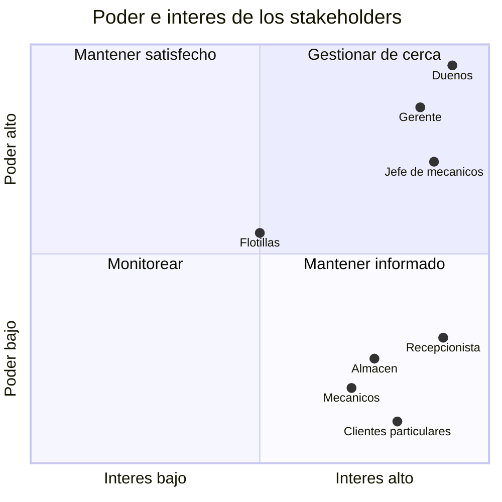

# P2-T1 · Matriz de interesados (poder e interés)

Tarea de equipo P2-T1 de la guía del segundo parcial. Parte de la tabla de stakeholders de la sección 3.4 del
Documento de Ingeniería y agrega la columna que pide la guía: qué requisitos salen de cada interesado.

Solo aparecen stakeholders del producto. El profesor y el equipo son stakeholders del proyecto académico y no van
aquí.

## Matriz

|  | Interés bajo | Interés alto |
| --- | --- | --- |
| **Poder alto** | Mantener satisfecho: — | Gestionar de cerca: dueños del taller, gerente, jefe de mecánicos |
| **Poder medio** | Mantener satisfecho: clientes de flotillas (interés medio) | — |
| **Poder bajo** | Monitorear: — | Mantener informado: recepcionista, mecánicos, encargado de almacén, clientes particulares |

## Detalle por interesado

| Stakeholder | Poder | Interés | Qué gana o pierde con el sistema | Requisitos que salen de él | Estrategia |
| --- | --- | --- | --- | --- | --- |
| Dueños del taller | Alto | Alto | Menos disputas por cobros y por daños; no pagan licencias | RF-06, RF-07, RF-10, RN-02, RN-04, restricción de costo $0 | Entrevistas y revisión en cada entrega; aprueban el alcance |
| Gerente | Alto | Alto | Ve la carga del taller y controla el crédito a flotillas | RF-10, RF-11, HU-22, HU-27, HU-29, RN-10 | Sesiones para definir reglas de crédito y reportes; pruebas de aceptación de su flujo |
| Jefe de mecánicos | Alto | Alto | Diagnostica, cotiza y asigna bahías desde la tableta | RF-05, RF-08.1, HU-08, HU-09, HU-11, RNF-02, RNF-03 | Prototipos en el taller (tableta, ruido, manos sucias) |
| Recepcionista | Bajo | Alto | Menos llamadas de seguimiento; recepción y fotos en un solo lugar | RF-03.1, RF-04, RF-09, HU-01, HU-04, HU-07, RNF-06 | Pruebas de usabilidad y capacitación |
| Mecánicos de bahía y de apoyo | Bajo | Alto | Órdenes claras; no capturan en el sistema | RN-09 | Capacitación breve y un canal para reportar dudas |
| Encargado de almacén | Bajo | Alto | Directorio de proveedores, costos y tickets por orden | RF-08.2, RF-08.3, HU-17, HU-18 | Entrevista sobre su flujo de compras; pruebas del módulo M6 |
| Clientes particulares | Bajo | Alto | Ven el estado del vehículo y autorizan desde el celular | RF-02.1, HU-02, HU-13, HU-14, HU-28, HU-30, RN-01 | Pruebas de usabilidad con algunos clientes; encuesta breve al cerrar el servicio |
| Clientes de flotillas | Medio | Medio | Condiciones de crédito claras; seguimiento de varios vehículos | RF-10, HU-22, RN-10 | Validar el flujo de crédito con un representante, junto con el gerente |

## Interesados que nadie ha entrevistado todavía

La entrevista del 19/10/2026 (Anexo A.2) se hizo con el cliente. No hay registro de que se haya hablado con el
encargado de almacén, con los mecánicos ni con un representante de flotillas. El guion de esta misma carpeta
(`guion-entrevista.md`) está pensado para ellos.

Fuente: sección 3.4 del Documento de Ingeniería y figura 3.1 (`docs/03-vision/mapa-poder-interes.py`).
