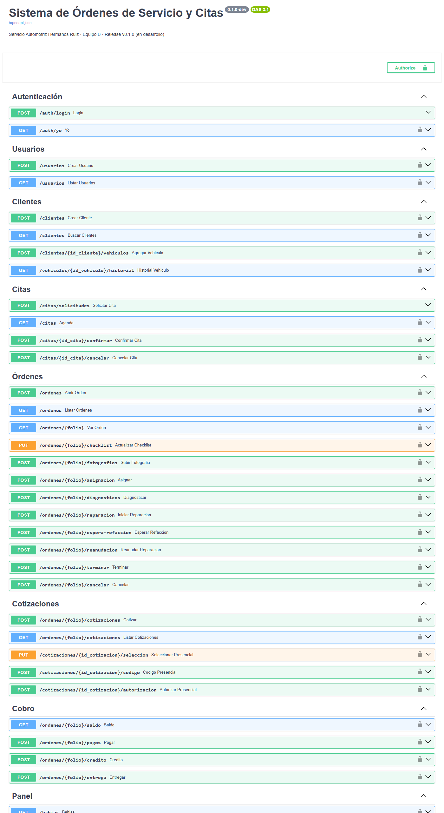
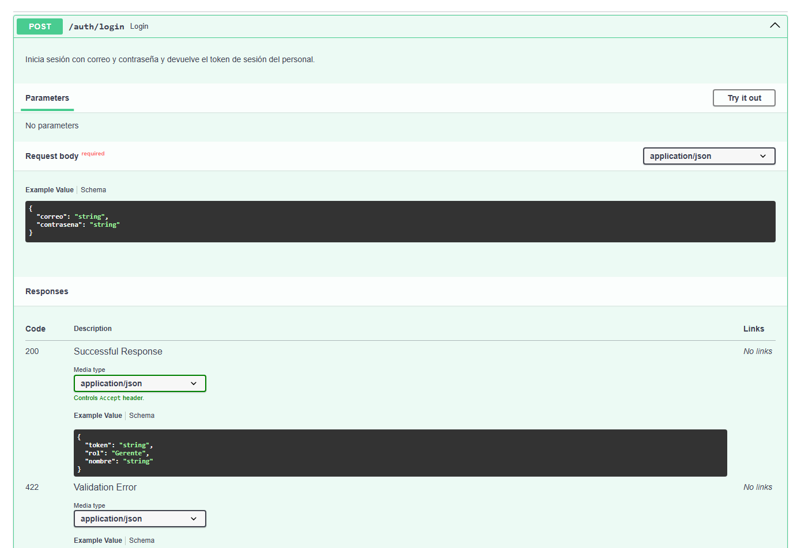
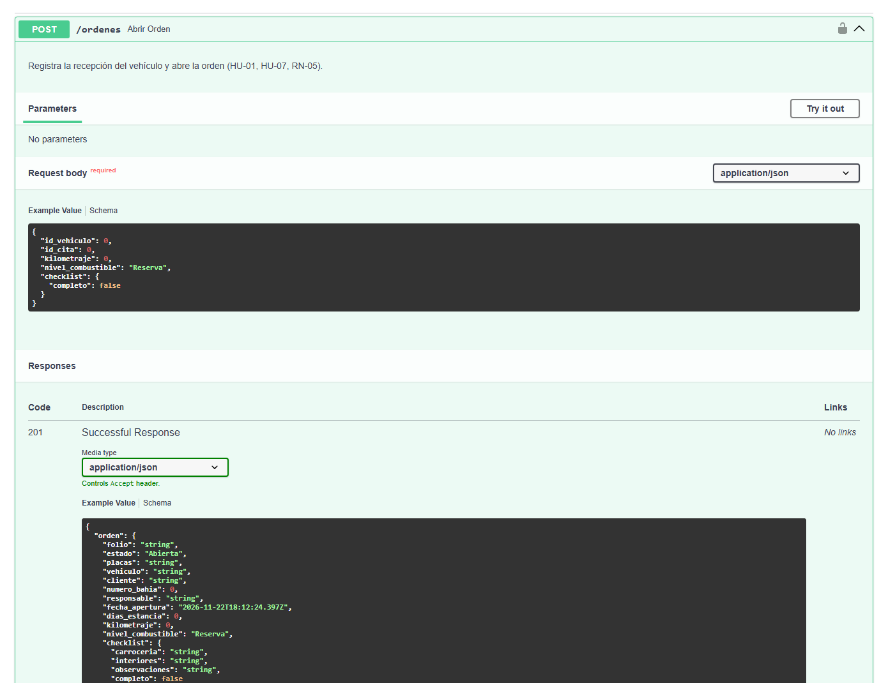

# Manual de usuario · Sistema de Órdenes de Servicio y Citas

Servicio Automotriz Hermanos Ruiz · Equipo B · versión del backend 0.1.0-dev (Release v0.1.0 en desarrollo)

> **Estado actual.** El sistema todavía no tiene interfaz gráfica: las pantallas del taller y del portal del
> cliente están diseñadas en los wireframes W-01 a W-06 (sección 4.10 del Documento de Ingeniería), pero aún no
> se construyen. Mientras tanto, el sistema se usa desde la **documentación interactiva de la API** (`/docs`),
> que permite ejecutar cada operación desde el navegador. Este manual explica ese uso. Todos los datos de los
> ejemplos son ficticios.

## 1. Antes de empezar

1. Instala y arranca el backend como indica el [README](../README.md) (secciones «Instalación y ejecución» y
   «Uso»). Para tener datos de ejemplo, carga la demostración:

   ```bash
   cd backend
   python -m app.semilla --demo      # usuarios, un cliente particular y una flotilla, todos ficticios
   uvicorn app.main:app --reload
   ```

   La contraseña de los usuarios de demostración sale de la variable `SEED_PASSWORD`; si no está definida, el
   comando la genera y la muestra una sola vez.

2. Abre en el navegador `http://localhost:8000/docs`. Verás las operaciones agrupadas por tema:

   

## 2. Usuarios y permisos

Cada persona entra con su correo y su contraseña, y solo puede usar las operaciones de su rol (HU-27). Los
usuarios de la demostración son:

| Rol | Correo de demostración | Qué hace en el sistema |
|---|---|---|
| Gerente | `gerente@taller.test` | Da de alta al personal, autoriza crédito a flotillas, cancela órdenes y consulta el panel |
| Recepcionista | `recepcion@taller.test` | Registra clientes y vehículos, confirma citas, recibe vehículos, cotiza, cobra y entrega |
| Jefe de Mecánicos | `jefe@taller.test` | Asigna bahía y mecánico, diagnostica, cotiza y controla la reparación |
| Encargado de Almacén | `almacen@taller.test` | Las refacciones y compras son de la Fase 2 |

Los mecánicos no entran al sistema: el jefe de mecánicos registra su trabajo desde la tableta.

## 3. Iniciar sesión

1. Despliega **POST `/auth/login`**, pulsa **Try it out** y escribe tu correo y contraseña:

   

2. Pulsa **Execute**. La respuesta trae tu `token`, tu `rol` y tu `nombre`.
3. Pulsa **Authorize** (arriba a la derecha), pega el token y confirma. Desde ese momento las operaciones con
   candado usan tu sesión. La sesión dura 8 horas.

## 4. Flujo de atención de un vehículo

### 4.1 Recepción (Recepcionista)

1. **Buscar al cliente:** **GET `/clientes`** con `q` igual al teléfono o a las placas. Ejemplo real con los
   datos de demostración (`q = DEMO-001`):

   ```json
   [{"id_cliente": 1, "tipo_cliente": "Particular", "nombre": "Cliente Ficticio Uno",
     "telefono": "9710000001", "correo": "cliente.demo@ejemplo.test",
     "vehiculos": [{"id_vehiculo": 1, "placas": "DEMO-001", "marca": "Nissan", "modelo": "Versa", "anio": 2019,
                    "tipo": "Automovil"}]}]
   ```

   Si no existe, regístralo con **POST `/clientes`** y su vehículo con **POST `/clientes/{id_cliente}/vehiculos`**
   (solo vehículos ligeros, RN-07).

2. **Abrir la orden:** **POST `/ordenes`** con el vehículo, el kilometraje, el nivel de combustible y el
   checklist:

   

   ```json
   {"id_vehiculo": 1, "kilometraje": 45210, "nivel_combustible": "Mitad",
    "checklist": {"carroceria": "Rayón en la puerta izquierda", "interiores": "Sin daños", "completo": true}}
   ```

   El sistema responde con el folio (`OS-2026-0001`) y la orden en estado `Abierta`. Si las 4 bahías están
   ocupadas, avisa con `alerta_sin_bahias` y la orden queda en espera; con el estacionamiento lleno (5
   vehículos) no permite recibir más (RN-05).

3. **Fotografías:** **POST `/ordenes/{folio}/fotografias`**, una por posición: `Frente`, `Trasera`,
   `Izquierda` y `Derecha`. Sin el checklist completo y las 4 fotografías, la orden no puede pasar a
   diagnóstico (RN-12).

### 4.2 Asignación y diagnóstico (Jefe de Mecánicos)

1. **GET `/bahias`** muestra qué bahías están libres.
2. **POST `/ordenes/{folio}/asignacion`** asigna la bahía y el mecánico responsable (RN-09).
3. **POST `/ordenes/{folio}/diagnosticos`** registra el diagnóstico; la orden pasa a `Diagnosticada`.

### 4.3 Cotización y autorización

1. La recepcionista o el jefe de mecánicos generan la cotización con **POST `/ordenes/{folio}/cotizaciones`**:
   conceptos de mano de obra, refacciones e insumos. Vale 5 días naturales (RN-11).
2. **Autorización remota:** el cliente recibe un enlace por correo. Desde él consulta su vehículo
   (**GET `/portal/{token}`**), elige los conceptos opcionales, pide su código de 6 dígitos y autoriza
   (**POST `/portal/{token}/codigo`** y **POST `/portal/{token}/autorizacion`**). También puede rechazarla.
3. **Autorización en mostrador:** la recepcionista usa **PUT `/cotizaciones/{id}/seleccion`**,
   **POST `/cotizaciones/{id}/codigo`** (el código llega al correo del cliente, que lo dicta) y
   **POST `/cotizaciones/{id}/autorizacion`** (RN-02).

### 4.4 Reparación (Jefe de Mecánicos)

- **POST `/ordenes/{folio}/reparacion`** inicia la reparación de una orden autorizada.
- **POST `/ordenes/{folio}/espera-refaccion`** pone la orden en espera y libera la bahía; al llegar la pieza,
  **POST `/ordenes/{folio}/reanudacion`** la regresa a una bahía libre (RN-06).
- Si hacen falta trabajos que suben el costo más del 10 %, se genera una re-cotización y el cliente debe
  autorizarla otra vez (RN-04).
- **POST `/ordenes/{folio}/terminar`** deja la orden lista para entrega.

### 4.5 Cobro y entrega (Recepcionista; crédito, Gerente)

1. **GET `/ordenes/{folio}/saldo`** y **POST `/ordenes/{folio}/pagos`** para cobrar.
2. Para una flotilla con crédito, el Gerente autoriza con **POST `/ordenes/{folio}/credito`**.
3. **POST `/ordenes/{folio}/entrega`** cierra la orden: solo con saldo cero o crédito autorizado (RN-10).

## 5. Otras operaciones

| Necesito… | Operación | Rol |
|---|---|---|
| Ver la agenda del día | GET `/citas` | Recepcionista, Gerente |
| Confirmar o cancelar una cita pedida en línea | POST `/citas/{id}/confirmar` o `/cancelar` | Recepcionista |
| Ver el historial de un vehículo | GET `/vehiculos/{id}/historial` | Recepcionista, Gerente, Jefe de Mecánicos |
| Ver las órdenes abiertas | GET `/ordenes` | Recepcionista, Jefe de Mecánicos, Gerente |
| Ver el panel del taller | GET `/panel` | Gerente |
| Dar de alta a un integrante del personal | POST `/usuarios` | Gerente |

## 6. Mensajes de error frecuentes

| Respuesta | Qué significa | Qué hacer |
|---|---|---|
| 401 | No hay sesión o el token venció | Inicia sesión otra vez y pulsa **Authorize** |
| 403 | Tu rol no puede usar esa operación | Pide a quien tenga el rol que la haga |
| 409 con `regla` | Se violó una regla de negocio (por ejemplo, RN-12 sin fotografías) | Lee el mensaje, completa lo que falta y repite |
| 422 | Falta un dato o tiene un formato inválido | Revisa el cuerpo de la petición contra el ejemplo de `/docs` |
